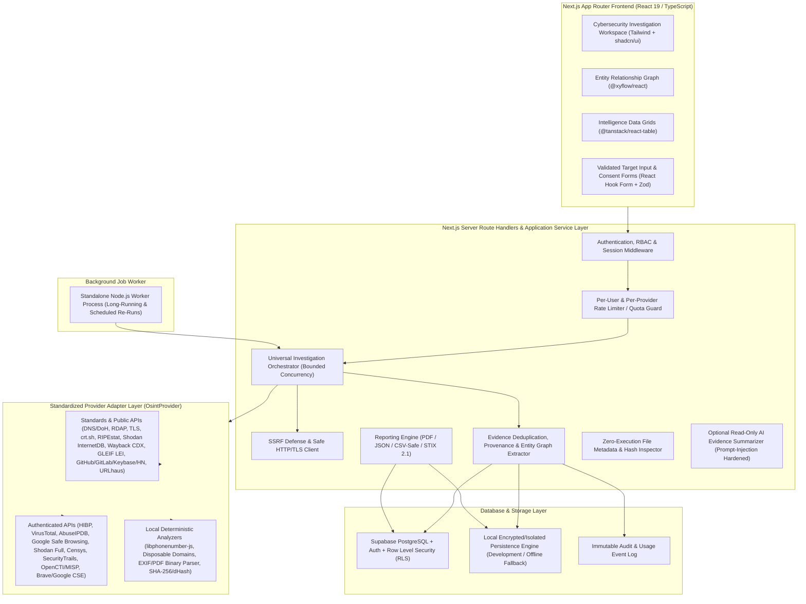

# Sentinel OSINT — System Architecture

## 1. Executive Summary

**Sentinel OSINT** is a production-oriented, defense-in-depth, all-in-one Open Source Intelligence (OSINT) and threat-intelligence investigation platform built for defensive cybersecurity analysts, fraud investigators, infrastructure researchers, and authorized security teams.

Sentinel consolidates multi-source public intelligence across nine operational domains (Identity, Domain/DNS, IP/Network, Web/URL, Social/Username, Threat Intelligence, Image/Document Metadata, Organization/Corporate Registries, and Historical Archives) into a unified evidence pipeline with strict provenance tracking, uncertainty-aware relationship graphing, case management, and formal multi-format reporting.

---

## 2. High-Level Architecture



---

## 3. Core Architectural Principles

1. **Verifiable Provenance Over Raw Aggregation**: Every finding and entity relationship records its originating provider ID, source URL, query timestamp, observation timestamp, confidence classification (`confirmed`, `high`, `medium`, `low`, `unverified_heuristic`), and data sensitivity level.
2. **Explicit Provider Statuses**: No provider is ever faked or mocked in production code. Every adapter returns one of:
   - `available` / `completed`
   - `partial`
   - `not_configured` (when required API credentials are absent)
   - `rate_limited` (with retry-after metadata)
   - `failed` (with structured error diagnostic)
   - `unsupported`
3. **Zero Silent Third-Party Disclosure**: Investigations display a clear Provider Disclosure list before execution so analysts know which external APIs will receive target identifiers, and can restrict execution to passive/local/standards-based providers when investigating sensitive indicators.
4. **Uncertainty Preservation & Non-Inferential Safeguards**: Coincidental username matches or GeoIP network estimates are never elevated to personal identity confirmation or physical street addresses.
5. **Dual-Mode Persistence (Supabase PostgreSQL + Local Persistent Engine)**:
   - Production deployments bind directly to **Supabase PostgreSQL** and **Supabase Auth** with comprehensive Row Level Security (RLS) across all 19 tables (`supabase/migrations/0001_sentinel_osint_schema.sql`).
   - Local standalone environments without external Supabase credentials automatically operate against a local ACID-safe file-backed relational repository (`.data/sentinel-db.json` with mutex locking, `scrypt` password hashing, signed HttpOnly session tokens, and strict server-side user/workspace row isolation) using the exact same repository interfaces and authorization rules.

---

## 4. Directory Structure

```text
sentinel-osint/
├── docs/                           # Extended architectural specifications
├── supabase/
│   └── migrations/
│       └── 0001_sentinel_osint_schema.sql  # Full 19-table PostgreSQL DDL + Indexes + RLS
├── worker/
│   └── index.ts                    # Dedicated background worker for queued OSINT jobs
├── src/
│   ├── app/                        # Next.js App Router pages and API route handlers
│   │   ├── (auth)/                 # Login, Register, Password Reset, Ethical Use Modal
│   │   ├── (dashboard)/            # Protected analyst workspace routes (16 navigation views)
│   │   └── api/                    # Server-side REST endpoints (auth, investigations, cases, providers, files, reports, graph)
│   ├── components/                 # UI & Domain components (Dashboard, Graph, Tables, Modals)
│   ├── lib/
│   │   ├── auth/                   # Session management, RBAC, password hashing, MFA verification
│   │   ├── db/                     # Unified Repository layer (Supabase + Local Persistence)
│   │   ├── engine/                 # Universal Investigation Orchestrator & Graph Extractor
│   │   ├── providers/              # Standardized OsintProvider<TInput, TResult> implementations
│   │   ├── reports/                # PDF, JSON, CSV (formula-safe), and STIX 2.1 generators
│   │   ├── security/               # SSRF guard, IP range classifier, rate limiter, file validator, sanitizer
│   │   └── validation/             # Zod schemas for targets, cases, reports, and API payloads
│   └── types/                      # Canonical TypeScript interfaces for OSINT domain models
└── tests/                          # Automated unit, integration, security regression, and E2E tests
```

---

## 5. Data Flow for an Investigation

1. **Target Submission & Classification**: User submits a target (`email`, `domain`, `ip`, `url`, `username`, `phone`, `file_hash`, `organization`, or uploaded file) along with investigation scope, purpose justification, and external provider consent.
2. **Validation & SSRF Pre-Check**:
   - Input is validated and normalized (e.g., Punycode IDNA conversion for domains, E.164 for phones, lowercase hex for hashes).
   - If the target is an IP or URL, `ssrf-guard.ts` verifies that it is not loopback (`127.0.0.0/8`, `::1`), RFC 1918 private (`10/8`, `172.16/12`, `192.168/16`), link-local (`169.254.0.0/16`, `fe80::/10`), cloud metadata (`169.254.169.254`, `metadata.google.internal`), carrier-grade NAT (`100.64.0.0/10`), or multicast.
3. **Provider Selection & Bounded Execution**:
   - The `InvestigationOrchestrator` selects all registered `OsintProvider` adapters matching `targetType`.
   - Adapters check `isConfigured()`. Unconfigured keyed adapters immediately emit a `not_configured` `ProviderExecution` record without making network calls.
   - Configured adapters run concurrently with a bounded semaphore (`MAX_CONCURRENCY = 4`) and strict per-adapter `AbortSignal.timeout`.
4. **Normalization, Entity Extraction & Deduplication**:
   - Raw provider responses are mapped into normalized `Finding`, `Entity`, `EntityRelationship`, and `EvidenceSource` records.
   - Duplicate findings and edges are merged while preserving all contributing `EvidenceSource` citations.
5. **Persistence & Audit Logging**:
   - Records are persisted to the user's isolated workspace, linked to an optional `Case`, and logged in `audit_events` and `usage_events`.
